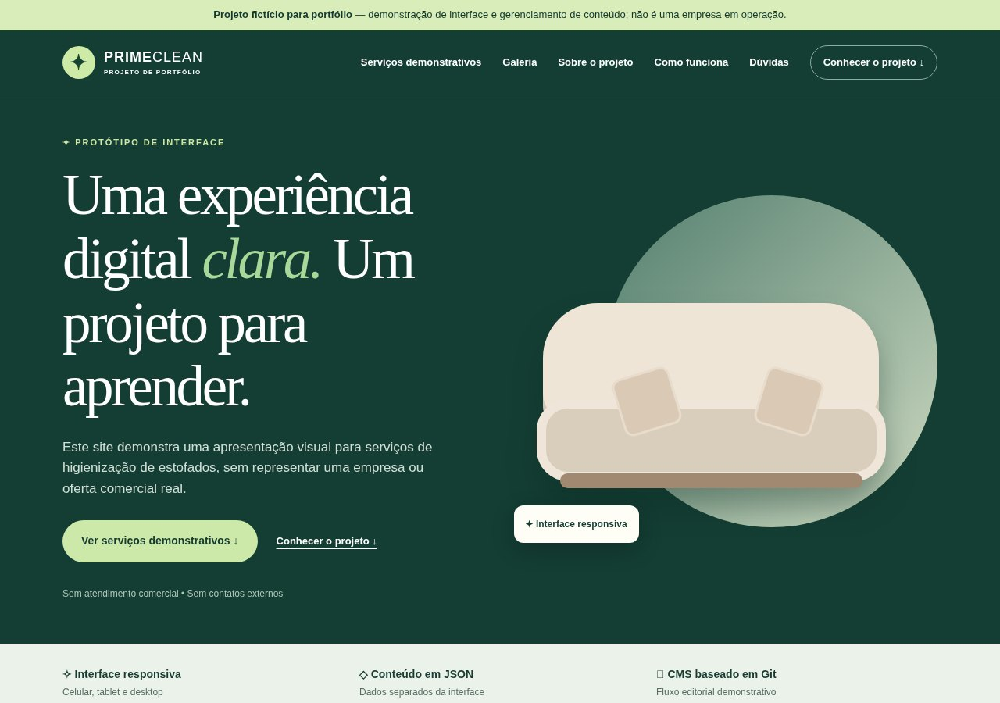
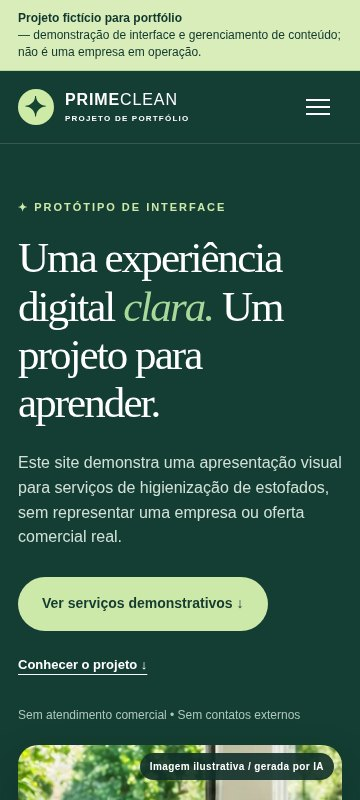

# Prime-Clean — case fictício de portfólio

> **Projeto fictício para portfólio — demonstração de interface e gerenciamento
> de conteúdo; não é uma empresa em operação.**

A Prime-Clean é uma marca criada para o portfólio de dois desenvolvedores em
formação. O case mostra como construir uma interface estática responsiva,
separar conteúdo dos componentes visuais e preparar um fluxo editorial baseado
em Git. Não existem empresa, clientes, atendimento ou contatos comerciais.

## Objetivo e público

O objetivo é demonstrar fundamentos de frontend, acessibilidade, conteúdo
estruturado, automação de QA e documentação de publicação. O público pretendido
é formado por recrutadores, pessoas desenvolvedoras iniciantes e avaliadores de
portfólio que queiram inspecionar tanto a interface quanto as decisões técnicas.

O tema de higienização serve apenas como contexto visual. Imagens de serviços e
comparações são sintéticas, geradas por IA e rotuladas como simulação; não são
trabalhos realizados nem garantias de resultado.

## Capturas reais do ambiente local





As capturas foram obtidas localmente com Chromium em 1280 × 900 e 360 × 800 px.
O procedimento e o resultado da verificação estão em
[`docs/capturas/README.md`](docs/capturas/README.md). Elas não representam um
deploy público.

## Stack e recursos

- HTML semântico, CSS responsivo e JavaScript puro, sem framework ou build;
- três arquivos JSON em `data/` para site, serviços e comparações;
- foto principal, cinco cartões e três comparadores com imagens sintéticas;
- navegação por teclado, foco visível, menu móvel e respeito a movimento reduzido;
- `.pages.yml` para demonstrar edição de textos, listas e mídias no Pages CMS;
- `_headers` com CSP e cabeçalhos de segurança para Cloudflare Pages;
- validador Python com biblioteca padrão, fixtures e GitHub Actions.

## Arquitetura

O navegador recebe arquivos estáticos e `app.js` busca os JSONs por HTTP. O
frontend valida tipos e caminhos locais antes de inserir textos com
`textContent`. Assim, conteúdo editorial fica separado do layout sem introduzir
backend, banco de dados ou etapa de build.

O comparador só publica registros completos marcados como demonstrativos. Os
contatos permanecem vazios e todos os CTAs navegam dentro da página. O Pages CMS
é uma camada editorial externa baseada em commits Git; ele não faz parte do
runtime nem adiciona dependências npm.

A foto principal também vem de `data/site.json`. Se ela estiver oculta ou
falhar, a ilustração CSS acessível permanece no lugar. Serviços podem continuar
visíveis sem foto usando um fallback gráfico; pares antes/depois incompletos não
são exibidos.

## Divisão de trabalho em dupla

A documentação não atribui commits anteriores a uma pessoa específica. Para
manter uma divisão verificável sem inventar autoria, o projeto trabalha com duas
frentes e revisão cruzada:

- **Frente de interface:** HTML, CSS, responsividade, acessibilidade e revisão
  visual;
- **Frente de conteúdo e qualidade:** JSON, schema do Pages CMS, validação,
  documentação e CI.

Cada mudança passa pela revisão da outra frente antes do merge. As frentes podem
trocar de responsável para que ambos pratiquem as duas áreas.

## Executar e testar

Pré-requisitos: Python 3.10+ e Node.js. Nenhuma biblioteca adicional é exigida.

```bash
python3 scripts/validar_conteudo.py
python3 scripts/auditar_midias.py
python3 -m unittest discover -s tests -p "test_*.py" -v
node --check app.js
python3 -m http.server 8000
```

Abra `http://localhost:8000`. O resultado esperado do validador começa com:

```text
OK: dados do repositório válido; 12 imagem(ns) local(is) verificada(s).
OK: 12 mídia(s) referenciada(s) existe(m); 0 arquivo(s) órfão(s).
```

Os 11 testes devem terminar com `OK`; `node --check` não produz saída em
sucesso. Falhas retornam código diferente de zero e identificam arquivo, índice
e campo. Consulte [`QA-PUBLICACAO.md`](QA-PUBLICACAO.md) para o checklist.

## Publicação e indexação

A equipe optou explicitamente por permitir a indexação da publicação principal
do portfólio. O bloqueio global `X-Robots-Tag: noindex, nofollow` foi removido de
`_headers`, preservando a CSP e os demais cabeçalhos. Previews do Cloudflare
Pages continuam recebendo `X-Robots-Tag: noindex` automaticamente.

Nenhum deploy ou domínio é declarado neste repositório. O passo a passo, a
configuração sem framework e os comandos de verificação com uma URL real estão
em [`DEPLOY-PORTFOLIO.md`](DEPLOY-PORTFOLIO.md).

## Pages CMS

O schema permite gerenciar a foto principal, fotos dos serviços e pares
antes/depois. Campos de visibilidade ocultam conteúdo sem apagar arquivos, e
`order` controla a ordem pública. A auditoria de mídia bloqueia a limpeza de um
caminho ainda referenciado e lista órfãos sem removê-los automaticamente.

A interface hospedada do Pages CMS ainda precisa ser homologada com uma conta
que tenha acesso legítimo ao repositório. Não há token, senha ou credencial no
projeto.

Consulte [`MANUAL-PROPRIETARIO.md`](MANUAL-PROPRIETARIO.md) e
[`plugins/PAGES-CMS.md`](plugins/PAGES-CMS.md) para o fluxo editorial. A matriz
de operações e exclusão segura está em
[`docs/AUDITORIA-MIDIAS-CMS.md`](docs/AUDITORIA-MIDIAS-CMS.md).

## O que aprendemos / decisões técnicas

- Um site pequeno pode separar conteúdo e interface sem adotar um framework.
- Validar JSON, tipos e caminhos reduz falhas antes do deploy.
- Dados configuráveis devem chegar ao DOM por `textContent` e URLs locais
  permitidas.
- Conteúdo sintético precisa de rótulos visuais e regras editoriais, não apenas
  uma observação escondida na documentação.
- Fixar Actions por SHA e usar testes da biblioteca padrão mantém o custo e a
  superfície de dependências baixos.
- Produção e preview exigem políticas de indexação diferentes: o case pode ser
  encontrável enquanto versões temporárias permanecem fora dos buscadores.

## O que ainda falta

- testar login e funcionamento real do painel Pages CMS;
- homologar upload, substituição e limpeza de mídia em uma branch segura;
- confirmar o commit gerado pelo CMS e o fluxo completo até o preview;
- homologar no painel a trava operacional de não excluir mídia referenciada;
- executar e registrar o primeiro deploy com sua URL HTTPS real;
- confirmar os cabeçalhos e respostas `200` na hospedagem;
- revisar novamente os limites do plano gratuito antes da publicação.

Os três pares demonstrativos já existem e são carregados pelo comparador. Falta
homologar no CMS o fluxo de substituição dessas imagens, sem remover sua
rotulagem sintética.

## Limitações

- não oferece orçamento, atendimento, formulário ou contratação;
- não possui telefone, e-mail, endereço, domínio ou perfil social;
- não usa analytics, autenticação própria, banco de dados ou API de aplicação;
- não comprova que o Pages CMS ou o Cloudflare Pages foram publicados;
- não representa uma empresa nem resultados de serviços reais.

## Evolução: painel administrativo próprio (em desenvolvimento)

A estrutura de banco e segurança do futuro painel com login está documentada em [`docs/PAINEL-ADMIN-SUPABASE.md`](docs/PAINEL-ADMIN-SUPABASE.md). O planejamento de migração das fotos está em [`docs/ADMIN-MIGRACAO-MIDIAS.md`](docs/ADMIN-MIGRACAO-MIDIAS.md) e o escopo para Codex em [`docs/ADMIN-CODEX-HANDOFF.md`](docs/ADMIN-CODEX-HANDOFF.md). A interface administrativa ainda **não existe**; o site publicado continua usando os JSON locais e o Pages CMS permanece como solução legada até o cutover homologado.
